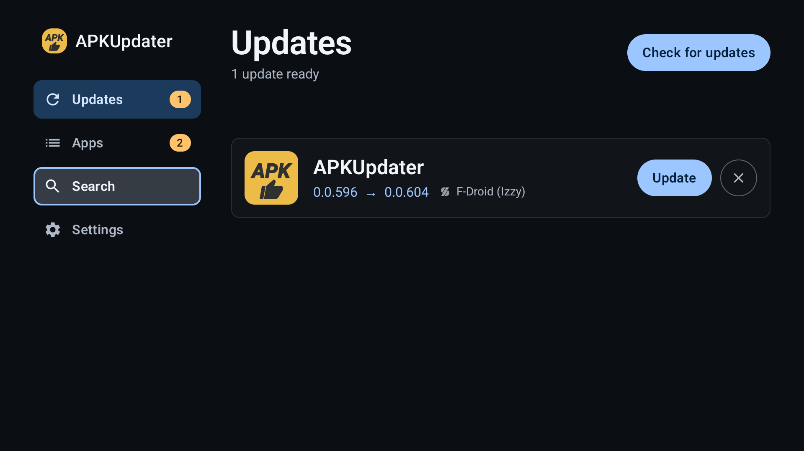
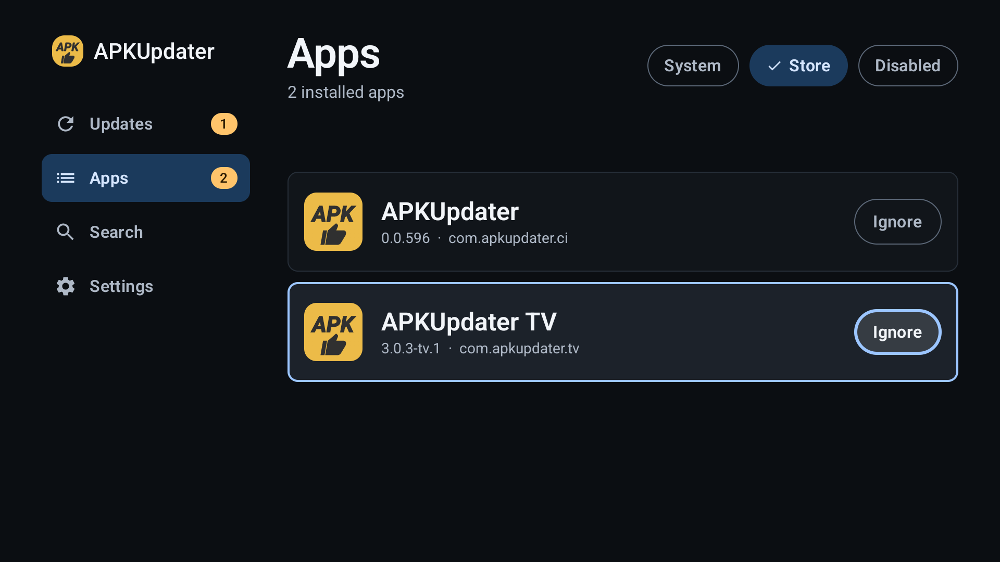
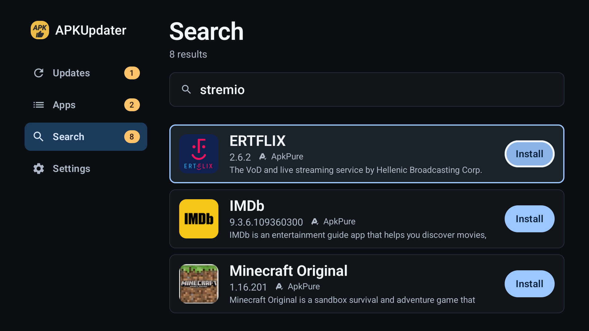
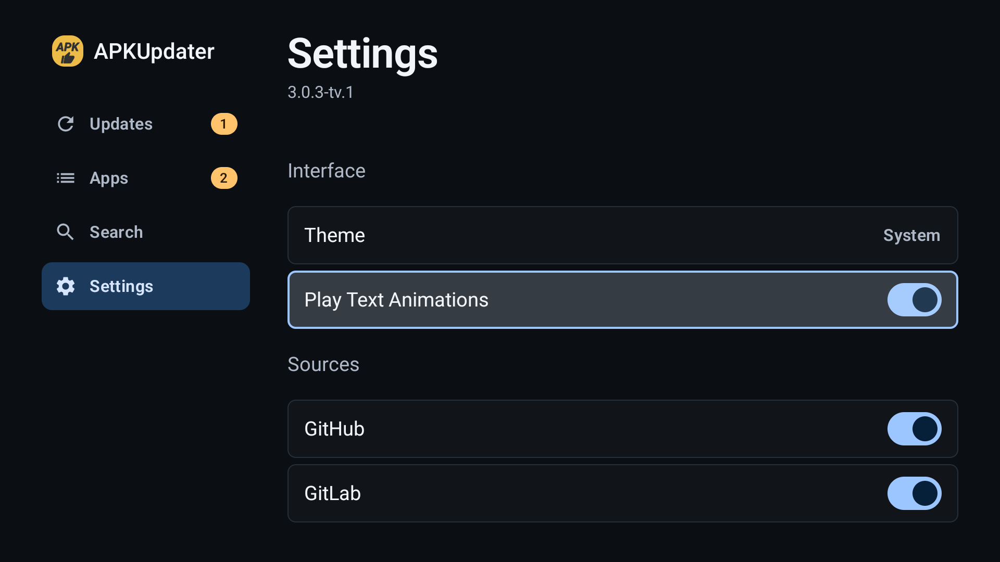
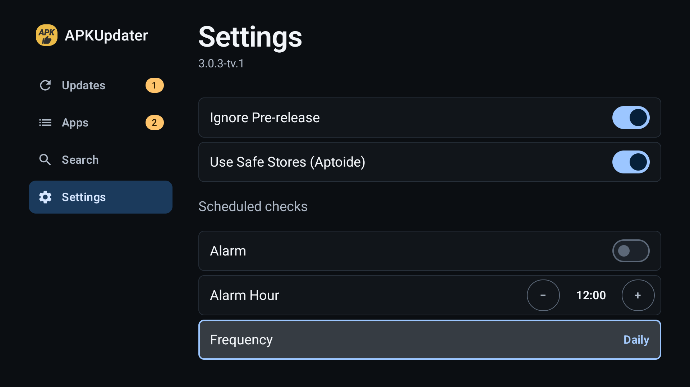
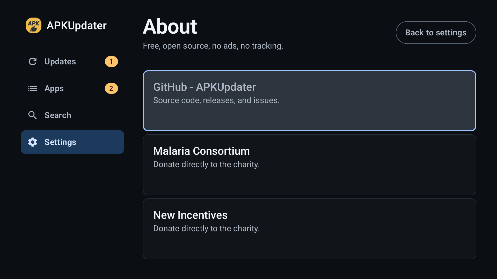

# APKUpdater TV

**A ten-foot fork of [APKUpdater](https://github.com/rumboalla/apkupdater).** Same updater
engine, same sources, same scheduled checks — with the TV surface rebuilt for a remote and
a sofa instead of a phone held in one hand.

Forked from `rumboalla/apkupdater` at tag **3.0.3**. The phone UI is untouched and still the
default everywhere else; the TV UI takes over on Leanback devices and can be forced on from
Settings.

| | |
| --- | --- |
| Package | `com.apkupdater.tv` — installs alongside upstream, not over it |
| Version | `3.0.3-tv.1` (versionCode 5201) |
| Min / target SDK | 21 / 34 |
| License | GPL-3.0 |

## Screenshots

| Updates | Apps |
| --- | --- |
|  |  |
| **Search** | **Settings** |
|  |  |
| **Scheduled checks** | **About** |
|  |  |

All captures are 1080p from a Google TV emulator, driven with a D-pad, on this build.

## Not cut off at the edge

The one thing lists on a TV usually get wrong: a row sliced in half by the bottom of the
panel. Here the viewport is trimmed to a whole number of rows and focus moves the list by
whole rows, so the bottom edge always lands between two rows. Nothing is ever half visible,
and the focused row is always whole.

## Why a fork

Upstream's TV support is the phone layout rendered on a big screen. At three metres that
means small text, no focus model worth the name, and controls that a D-pad cannot reach
comfortably. This fork keeps the engine and replaces the surface.

## What changed

- **Permanent left rail** (Updates / Apps / Search / Settings) with the current tab lit, a
  10-foot type scale, overscan-safe margins, and one focus ring — the only glowing thing on
  screen. No build stamp or footer; the version lives in Settings.
- **Rows, not cards.** Icon, name, `old → new`, source, one-line changelog, and exactly one
  primary action (Update) plus a quiet skip. The row highlights when its action holds focus;
  the row itself is not a click target.
- **Apps** with three inclusion filters (System / Store / Disabled) and one action per row
  (Ignore / Include).
- **Search** with a single field, debounced queries, and a remote that cannot get stuck in
  it: down hands focus to the first result, left returns to the rail, and losing focus
  dismisses the IME.
- **Settings** with switches instead of sliders, a stepper for the alarm hour, cycle rows
  only where there are 2–3 values, and About as a proper sub-page (Back closes it, focus is
  restored).
- **Loading is a skeleton of rows**, not a spinner; empty and error states explain, and the
  header keeps the single primary action.
- **3 dp focus rings** on small controls, 2 dp on full-width rows — a 2 dp line disappears
  at three metres.

The rationale and the token/behaviour spec live in [PRODUCT.md](PRODUCT.md) and
[DESIGN.md](DESIGN.md).

Everything else is upstream: the seven sources, the WorkManager schedule, notifications,
direct and root install, and the four route names (so notification intents still resolve).

## Install

### Release APK

Download `apkupdater-tv-3.0.3-tv.1.apk` from [Releases](../../releases) and open it on the
TV, or push it over ADB:

```bash
adb connect <TV_IP>:5555
adb install -r apkupdater-tv-3.0.3-tv.1.apk
```

On first run the app opens **Install unknown apps** and asks you to allow it — it needs that
to hand downloads to the system installer.

### Side by side

The package is `com.apkupdater.tv`, so it does not replace `com.apkupdater` /
`com.apkupdater.ci`. Both can be installed at once; uninstall whichever you do not want.

### First run

1. The app opens on **Updates**. Press right for the header action, right again into the
   list, OK to update.
2. **Settings → Sources** — enable the sources you actually use.
3. **Settings → Scheduled checks** — off by default; turn it on, pick the hour with the
   stepper, choose a frequency.

## Build

```bash
export JAVA_HOME=/path/to/jdk17
export ANDROID_HOME=/path/to/android-sdk     # platform 34, build-tools 34.0.0
./gradlew assembleRelease
# -> app/build/outputs/apk/release/com.apkupdater.tv-release.apk
```

Signing is read from `local.properties` (git-ignored):

```properties
keystore.file=/absolute/path/to/keystore.jks
keystore.password=…
keystore.keyalias=…
keystore.keypassword=…
```

Without those keys the release build falls back to the debug keystore, which is fine for
local testing but cannot update an installed copy signed with another key.

## Upstream

- Source: [rumboalla/apkupdater](https://github.com/rumboalla/apkupdater) — all credit for
  the engine, the sources and the phone UI belongs there.
- Issues with the updater itself belong upstream; issues with the TV layout belong here.
- Translations: the fork adds a handful of English `tv_*` strings and does not yet translate
  them. PRs welcome.

## License

GPL-3.0, unchanged. Copyright &copy; 2016-2023 rumboalla; TV surface modifications
&copy; 2026 the fork's author. See [LICENSE](LICENSE).
